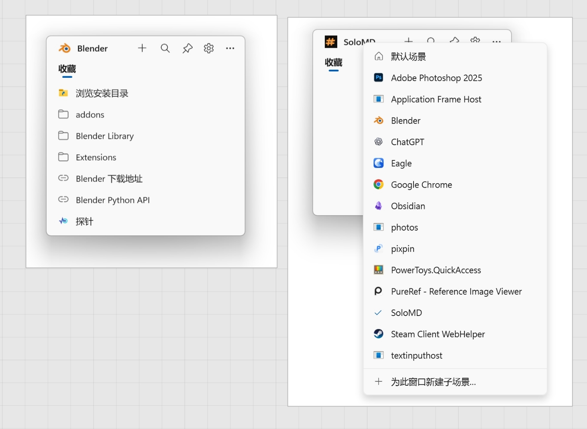
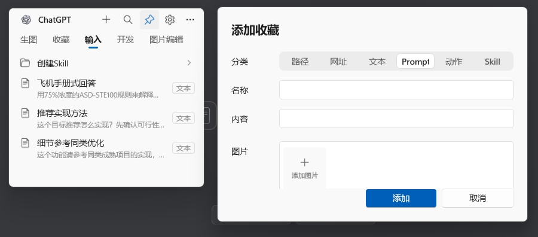
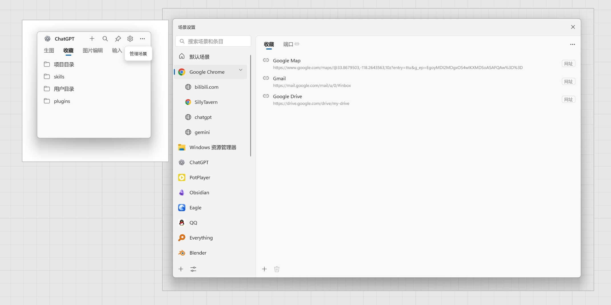
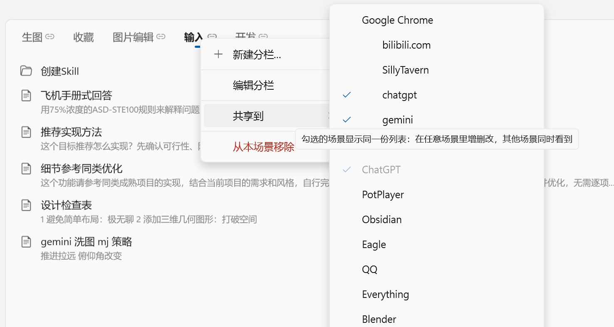
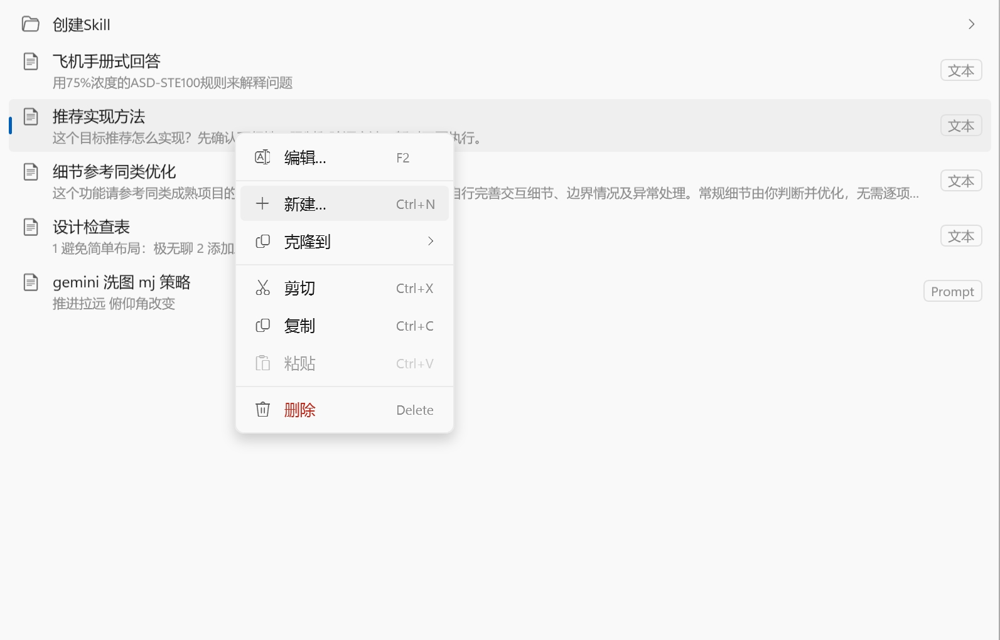
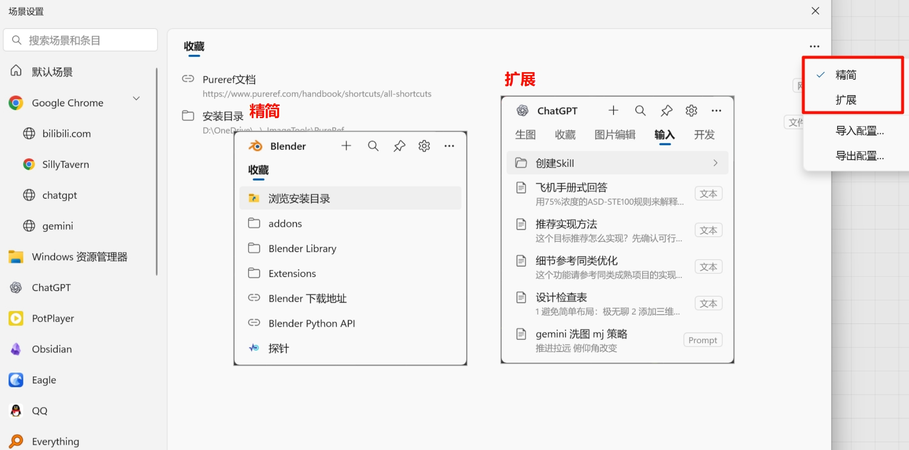
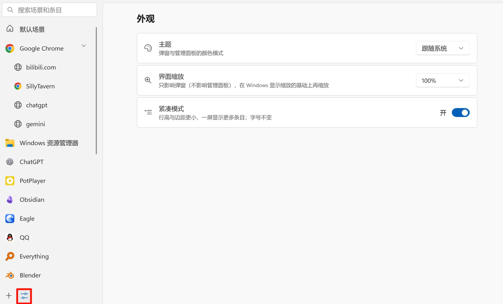
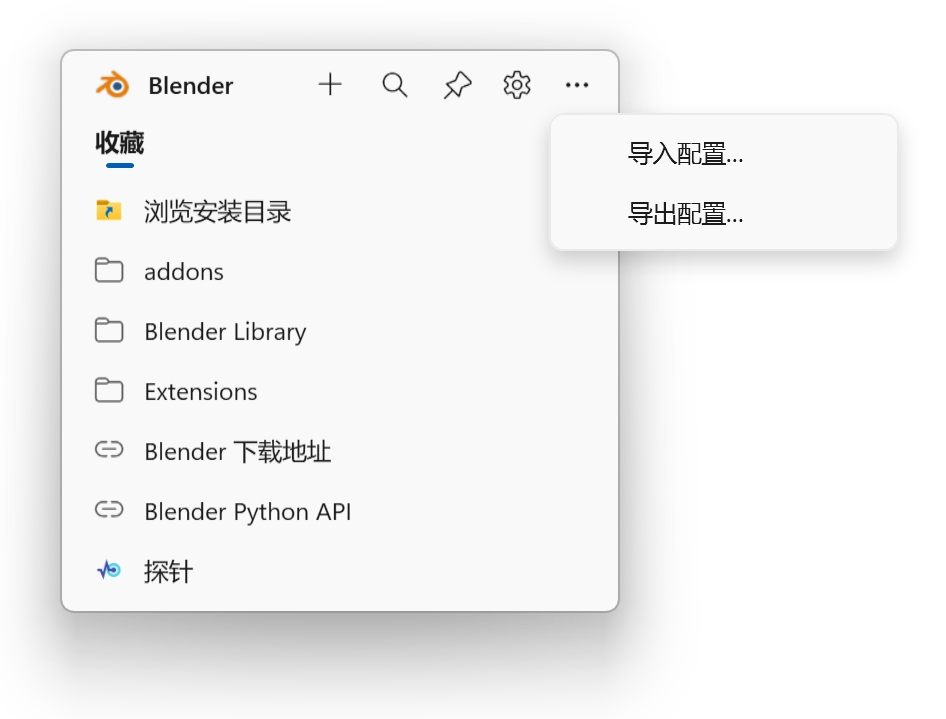

# 快速收藏夹

快速收藏夹可以保存常用的文件和文件夹路径、网页地址、常用输入文本、AI 提示词（Prompt）及本地 Skill 入口，并按当前使用的程序显示对应收藏。点击条目即可打开目标、输入文字或调用 Skill；Prompt 和 Skill 可附加参考图片，悬停查看。
## 下载与启动

[下载](https://github.com/RainskyCG/SceneFavorites/releases/tag/v0.1.0) · [所有版本](https://github.com/RainskyCG/SceneFavorites/releases)

下载 Release 中的 ZIP，解压到可写文件夹，运行 **SceneFavorites.exe**，无需安装 Quicker。关闭窗口后程序仍留在托盘，可右键退出。

Quicker 动作暂未在此仓库发布，下面标注 Quicker 的功能仅适用于动作版。

默认快捷键 Ctrl + Shift + Q 呼出，可在场景设置中修改
Quicker版安装动作后点击呼出，可右键>信息>设置快捷键，自定义快捷键。

启动场景默认为全局，添加场景后会自动切换为当前进程场景，弹窗左上角场景可以切换场景，通过钉固按钮固定。

## 添加条目

- 路径：保存文件、文件夹或程序的位置，点击条目即可打开。
- 网址：保存网页地址，点击条目即可用浏览器打开。
- 文本：保存常用文字，点击条目即可输入到目标输入框。
- Prompt：保存 AI 提示词和参考图片，点击只输入提示词，图片用于悬停预览。
- 动作（仅 Quicker 版）：选择已有的 Quicker 动作，点击条目即可运行。
- Skill：选择本地技能文件路径，点击输入调用文字；可添加参考图片，悬停查看，不会自动安装技能或发送图片。

可粘贴截图、复制的图片文件、本地完整路径或 HTTP(S) 图片直链。网址会下载成附件；普通网页、需要登录的链接不支持。每张最多 20 MB，最多 8 张。下载完成后再保存；取消编辑会停止下载。

## 场景与分栏

弹窗右上角设置按钮进入场景设置面板，左侧管理场景，右侧管理条目内容。

### 场景
- 默认场景：保存全局条目，设置后会在所有场景出现。
- 程序场景：关联指定进程，根据前台进程弹窗菜单呼出时显示不同场景对应的内容。
- 子场景：按窗口标题或网址关键词细分，可以为不同的网址或者不同的子窗口设置不同的子场景。
右键场景：重命名、更换关联程序、创建子场景或删除场景。

  
### 分栏
  
- 对条目内容进行分离，如收藏、文本、Skills；右键可新建、编辑或删除。
- 同一分栏内容可以关联到多个场景，在多个场景同步显示编辑。

**管理条目**

- 单击选择，双击编辑；Ctrl 多选，Shift 连续选择。
- 拖动条目可调整顺序，也可拖到左侧其他场景或顶部其他分栏。
- 右键条目可编辑、剪切、复制、删除；空白处可添加条目、粘贴或新建分组。

**菜单与设置**

- 精简／扩展：精简主要显示名称；扩展增加内容摘要和类型，作用于当前分栏。
- 显示默认场景条目：决定当前程序场景是否同时显示通用收藏。

### 外观设置
 
调整主题、界面缩放和紧凑模式；程序可设置唤出快捷键。

## 备份和迁移

1. 点击弹窗或者场景设置右上角扩展菜单选择“导出配置”，保存 ZIP，收藏数据和图片会打包在内。
2. 选择“导入配置”，打开该 ZIP。导入会替换当前收藏，并先自动备份。

**Skill 文件不打包。** 换电脑后自行复制 Skill，并按需修改路径。

收藏数据保存在程序同目录的 `data/`。移动整个程序文件夹可保留数据；更新程序时保留该目录。

## 系统要求

Windows 10 / 11，.NET Framework 4.7.2 或更高版本。
